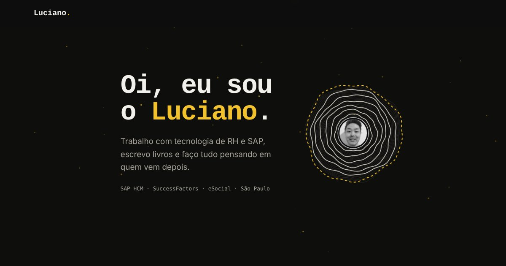

# Luciano, bom ancestral 🌱

Meu portfólio pessoal: **[luciano-arashiro.vercel.app](https://luciano-arashiro.vercel.app)**



> Deixo o caminho mais fácil para quem vem depois.

Trabalho com tecnologia de RH e SAP, escrevo livros e faço tudo pensando em quem vem depois. Este site conta essa história em seis capítulos: quem eu sou, como eu trabalho, o que eu crio e escrevo, meus livros, meus valores e como falar comigo.

---

## Como navegar

O site funciona como uma apresentação em folhas.

| Ação | Computador | Celular |
|---|---|---|
| Próximo capítulo | `↓`, roda do mouse ou espaço | deslizar para cima |
| Capítulo anterior | `↑` | deslizar para baixo |
| Detalhes do capítulo | `→` e `←` | deslizar para os lados |

O galho à esquerda mostra em que capítulo você está. Passe o mouse sobre ele para ver o nome de cada seção.

---

## A ideia por trás

Tudo o que a gente cria hoje, seja um sistema, um processo ou um texto, vai ser herdado por alguém amanhã. O site tenta mostrar isso também na forma:

- **Anéis de árvore** contam a trajetória, cada fase segurando a próxima.
- **Folhas que se sobrepõem** fazem a transição entre os capítulos.
- **Natureza ao fundo**: pólen, folhas caindo, flores desabrochando, céu estrelado, chuva e sementes ao vento.
- **Três temas**: preto e amarelo, floresta e colorido. Quem usa o tema escuro no sistema não leva clarão na troca de folhas.
- **Acessibilidade**: respeita a preferência de reduzir movimento, funciona pelo teclado e se ajusta a telas pequenas e a zoom.

---

## Como foi feito

Uma página só, sem framework e sem etapa de build: HTML, CSS e JavaScript puros, com as animações desenhadas em `<canvas>`. Publicado na Vercel direto a partir deste repositório.

```
index.html     a página inteira (estrutura, estilo e script)
favicon.svg    ícone da aba
og.jpg         imagem de prévia ao compartilhar o link
capas/         capas dos livros da série Autopia
fotos/         fotos usadas no site
```

Para rodar localmente, basta abrir o `index.html` no navegador.

Construído em parceria com o Claude, da Anthropic.

---

## Outros projetos

- [IRIS: Índice de Regeneração e Integração Social](https://poc-iris.vercel.app/)
- [Kotini: ferramentas de coaching](https://kotini-app-alpha.vercel.app/)
- [Blog de Autopia](https://autopialivros.blogspot.com/)

## Contato

[LinkedIn](https://www.linkedin.com/in/luciano-arashiro) · [99freelas](https://www.99freelas.com.br/user/luciano-a)

---

<sub>As fotos e as capas dos livros são pessoais e não estão liberadas para reuso.</sub>
